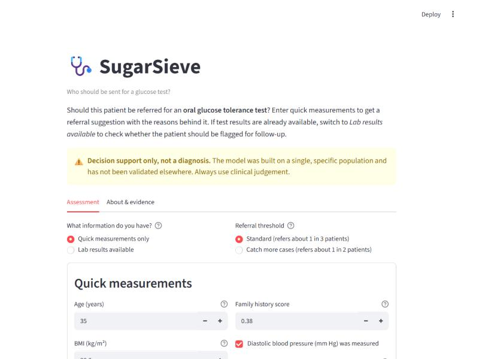
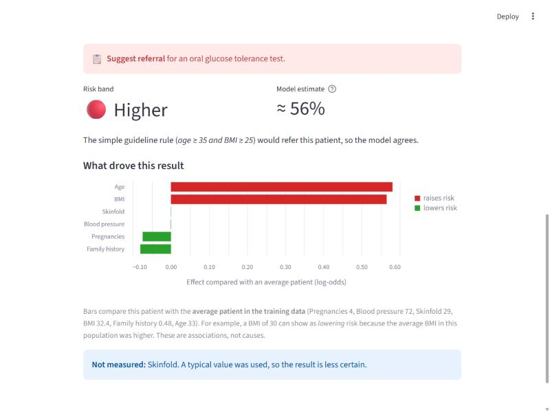

# SugarSieve: who should get a glucose test?

[](https://github.com/deepanshi-code/SugarSieve/actions/workflows/tests.yml)

*Screening works like a sieve: it filters out who needs the full test. SugarSieve checks how well quick measurements do that job.*

**🔗 Live app: [sugarsieve.streamlit.app](https://sugarsieve.streamlit.app/)**




📄 **[Full report](docs/report.md)** · 🧾 **[Model card](docs/model_card.md)** · 🌍 **[External validation on 5,298 US women](notebooks/05_external_validation.ipynb)**

## The question
Type 2 diabetes is confirmed with an **oral glucose tolerance test (OGTT)**: fasting, a glucose drink, a 2-hour wait and a blood draw.
It is too costly to give everyone. This project asks:

1. Using only **quick measurements** (age, BMI, blood pressure, pregnancies, family history, skinfold), can a model decide
   **who to refer for the test** better than a simple guideline rule?
2. If lab values *are* available, does a model add anything beyond **glucose alone**?

Full problem statement, baselines and success criteria (fixed before modelling): [docs/problem_definition.md](docs/problem_definition.md)

## Data
- **Development:** [Pima Indians Diabetes Database](https://www.openml.org/d/37) (NIDDK): 768 women aged 21+ of Pima heritage, Arizona, USA.
- **External validation:** [NHANES](https://wwwn.cdc.gov/nchs/nhanes/) 2005–2016 (CDC/NCHS, public domain): 5,298 US women aged 21+ without
  diagnosed diabetes and with a completed glucose tolerance test. Built by `python -m src.nhanes`.

Key findings from the [data audit](notebooks/01_data_audit.ipynb):
- The documentation says there are no missing values, but **zeros are used for missing values**. About **48 %** of rows have at least one impossible zero (e.g. insulin = 0).
- Treating those zeros as missing matters: insulin's predictive signal goes from ROC-AUC ≈ 0.56 to ≈ 0.75.
- The guideline rule (*Age ≥ 35 and BMI ≥ 25*) refers about 1 in 3 patients but catches only about **half** of the diabetes cases.

## Results
Judged against criteria fixed before seeing any results: on the held-out Pima test set ([notebook 03](notebooks/03_test_evaluation.ipynb)),
and on an independent NHANES population with a plan committed before outcomes were examined ([notebook 05](notebooks/05_external_validation.ipynb)).

| Question | Pima test (154 women) | NHANES external (5,298 women) |
|---|---|---|
| No-lab model vs guideline rule (cases caught at the same referral rate) | −5.6 points (−14.3 to +6.0) ❌ | **+6.9 points (+3.2 to +10.9) ✅** |
| No-lab model ROC-AUC | 0.730 | **0.739** (0.718–0.760) |
| Full model vs glucose alone (ROC-AUC) | +0.048 (+0.004 to +0.095) ✅ | **+0.027 (+0.008 to +0.047) ✅** |
| Calibration (mean predicted vs actual rate) | 0.35 vs 0.35 | 0.33 vs 0.085 ❌, fixed by recalibration |

**Key findings**
- **The model's ranking transfers to a new population; its probabilities don't.** ROC-AUC barely moved from Pima to NHANES, but predicted
  risks were about 4× too high until a single intercept recalibration (Brier score halved).
- **Against the guideline rule:** a tie in the small Pima test, and a modest, clear win in the large NHANES sample. The Pima interval included the NHANES effect.
- **The age story depends on the population.** In Pima nearly half of all cases are under 35, whom the age-gated rule can never refer
  ([notebook 04](notebooks/04_age_subgroups.ipynb)). In NHANES only 4 % are, and the model beat the rule in both age groups.
- **22 of 24 cases the full model missed had normal glucose at the exam**, which suggests later-onset diabetes that a single-visit model can't predict.
- Plain **logistic regression** beat Random Forest and Gradient Boosting in cross-validation ([notebook 02](notebooks/02_modelling.ipynb)).

## Roadmap
- [x] **Stage 1:** problem definition, success criteria, data audit
- [x] **Stage 2:** modelling with repeated CV: no-lab vs full models, baselines, selection, calibration, thresholds
- [x] **Stage 3:** final test-set evaluation with confidence intervals, error and subgroup analysis
- [x] **Stage 4:** Streamlit app (referral suggestion, risk band, explanation, limitations) and tests
- [x] Deployed to Streamlit Community Cloud: [sugarsieve.streamlit.app](https://sugarsieve.streamlit.app/)
- [x] **Stage 5:** [final report](docs/report.md): results, limitations, and what real use would need
- [x] **External validation** on NHANES with a pre-registered plan, a [model card](docs/model_card.md), and automated tests on GitHub

## Project structure
```
├── docs/problem_definition.md   # problem, user, baselines, success criteria
├── docs/report.md               # final report
├── docs/model_card.md           # intended use, data, performance, limits
├── docs/external_validation_plan.md   # written before NHANES outcomes were examined
├── data/raw/pima_diabetes.csv   # unchanged copy from OpenML
├── data/external/nhanes_validation.csv  # processed NHANES validation set
├── src/data.py                  # loading, zero→missing cleaning, fixed train/test split
├── src/models.py                # pipelines, guideline-rule baseline, screening metric
├── src/predict.py               # prediction logic used by the app (testable without the UI)
├── src/nhanes.py                # downloads NHANES and builds the validation set
├── app.py                       # Streamlit app
├── tests/                       # unit tests (run automatically by GitHub Actions)
├── models/                      # saved models + metadata.json (features, thresholds, CV scores)
└── notebooks/
    ├── 01_data_audit.ipynb
    ├── 02_modelling.ipynb
    ├── 03_test_evaluation.ipynb
    ├── 04_age_subgroups.ipynb    # exploratory follow-up
    └── 05_external_validation.ipynb
```

## How to run
```bash
python -m venv .venv
.venv\Scripts\activate          # macOS/Linux: source .venv/bin/activate
pip install -r requirements-dev.txt   # app + notebooks (requirements.txt = app only)

streamlit run app.py                  # the app
python -m unittest discover tests     # the tests
jupyter lab                           # the notebooks
python -m src.data                    # optional: re-download the Pima data
python -m src.nhanes                  # optional: download NHANES (~116 MB) and rebuild the validation set
```

## The app
A referral aid with two modes:
- **Quick measurements only:** should this patient be referred for a glucose tolerance test?
- **Lab results available:** should this patient be flagged for clinical follow-up?

For each patient it shows a referral suggestion, a **risk band** (lower / moderate / higher) instead of a precise percentage,
a chart of which values drove the result, and warnings that come from the evaluation (young patients, missing values,
and the fact that a negative result is not a clean bill of health). You can switch between a *standard* threshold, which refers
about 1 in 3 patients, and a *catch more cases* threshold, which refers about 1 in 2.

### Deploying (Streamlit Community Cloud, free)
1. Push this folder to a **public GitHub repository**.
2. Sign in at [share.streamlit.io](https://share.streamlit.io) with GitHub → **Create app** → pick the repo, branch `main`, file `app.py`.
3. Under **Advanced settings**, choose **Python 3.13**. The saved models were made with scikit-learn 1.8.0, and `requirements.txt` pins it.
4. Deploy. The app gets a public `*.streamlit.app` URL.

## Limitations
The models were trained on one community of women from the 1980s and validated on US women from 2005–2016. Men and other countries are
untested, and the probabilities need recalibrating for any new population. This is a **learning and research project, not a medical device**.
