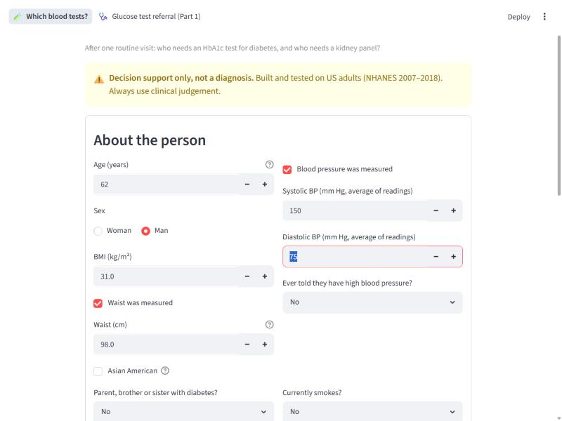
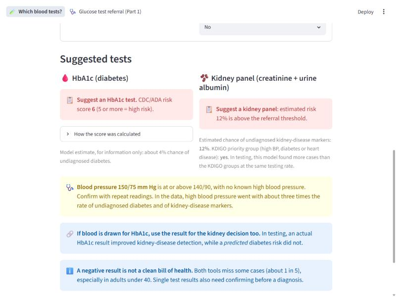

# SugarSieve: who needs which blood test?

[](https://github.com/deepanshi-code/SugarSieve/actions/workflows/tests.yml)

*Screening works like a sieve: it filters out who needs the full test. SugarSieve checks how well routine clinic information does that job,
and compares it honestly with the official tools clinics already use.*

**🔗 Live app: [sugarsieve.streamlit.app](https://sugarsieve.streamlit.app/)**




## At a glance

| | **Part 2: one visit, three connected conditions** | **Part 1: who should get a glucose test?** |
|---|---|---|
| Question | After a routine visit, who needs an **HbA1c** test (diabetes) and who needs a **kidney panel** (CKD)? High blood pressure links the two. | Using quick measurements, who should be referred for an oral glucose tolerance test? |
| Data | NHANES: 22,426 US adults (2007–2014) to train, 10,614 (2015–2018) to test once | Pima Indians Diabetes (768 women), validated on 5,298 NHANES women |
| Compared with | Official **CDC/ADA risk test** and **KDIGO 2024** priority groups | Age-and-BMI rule based on USPSTF 2021 |
| Main result | **Kidney model beats KDIGO.** **For diabetes, the CDC/ADA questionnaire is as good as a model.** | No better than the rule on Pima; modestly better on NHANES; probabilities needed recalibration |
| Read more | [Report](docs/part2_report.md) · [Plan](docs/part2_plan.md) · notebooks 10–12 | [Report](docs/report.md) · [Plan](docs/problem_definition.md) · notebooks 01–06 |

## How the work was done
- **Success criteria were written before looking at results** and committed to git, together with every later change and its reason,
  so the order can be checked: [Part 1](docs/problem_definition.md), [Part 1 validation](docs/external_validation_plan.md), [Part 2](docs/part2_plan.md).
- **Every model was compared with the tool it would replace,** at the same number of referrals, never on accuracy alone.
- **Test data was used once.** Model choices were made with cross-validation on training data only.
- **Negative results are reported.** Two of the six pre-registered main criteria were not met.
- **Formulas and guidelines were checked against their sources** (National Kidney Foundation, KDIGO 2024, CDC), not written from memory.
- **The code is tested:** 56 automated tests (formulas against hand-calculated values, data definitions, leakage, the bootstrap, the app)
  run on every push.

---

## Part 2: one visit, three connected conditions
**Question:** after one routine visit (questions, weight, waist, blood pressure), who needs an **HbA1c** test for undiagnosed diabetes,
and who needs a **kidney panel** (creatinine and urine albumin) for undiagnosed chronic kidney disease? Blood pressure is measured at the visit
itself, so it isn't predicted. It's the link between the two.

**Results on 2015–2018** ([notebook 12](notebooks/12_part2_test_evaluation.ipynb); 95 % CIs from a survey-design bootstrap):

| Pre-registered question | Result | Verdict |
|---|---|---|
| Diabetes model vs CDC/ADA questionnaire (cases caught at its referral rate) | −0.3 points (−4.2 to +3.6) | ❌ The official questionnaire is as good |
| Kidney model vs KDIGO priority groups | **+2.5 points (+1.0 to +4.0)**; ROC-AUC 0.79 vs 0.68 | ✅ |
| Predicted diabetes risk improves the kidney model | +0.0002 ROC-AUC | ❌ Same inputs, no new information |
| Actual HbA1c result improves the kidney model (exploratory) | +0.016 ROC-AUC (+0.012 to +0.020) | ✅ Real test results carry the connection |

**Key findings**
- **The conditions are strongly connected.** Undiagnosed diabetes more than doubles the rate of kidney-disease markers (29 % vs 13 %), and high
  blood pressure triples it. But only *new* information, such as an actual HbA1c result, can use that connection.
- **Fairness:** the race-blind diabetes model **underestimates risk for Asian American adults by more than half** (2.1 % predicted vs 5.1 %
  observed). The CDC/ADA score, which uses a lower BMI cut-off for them, does better. Leaving race out didn't make the model fair.
- **Calibration held up over time,** from 2007–2014 to 2015–2018 (predicted 4.3 % vs 4.0 %, and 18.1 % vs 17.0 %).

## Part 1: who should get a glucose test? (Pima)
**Question:** using quick measurements, can a model decide who to refer for an oral glucose tolerance test better than a simple guideline rule?
And if lab values are available, does a model add anything beyond glucose alone?

**Results** (Pima test set, [notebook 03](notebooks/03_test_evaluation.ipynb); NHANES validation with a plan committed before outcomes were
examined, [notebook 05](notebooks/05_external_validation.ipynb)):

| Question | Pima test (154 women) | NHANES (5,298 women) |
|---|---|---|
| No-lab model vs guideline rule (cases caught at the same referral rate) | −5.6 points (−14.3 to +6.0) ❌ | **+6.9 points (+3.2 to +10.9) ✅** |
| Full model vs glucose alone (ROC-AUC) | +0.048 (+0.004 to +0.095) ✅ | **+0.027 (+0.008 to +0.047) ✅** |
| Mean predicted vs actual rate | 0.35 vs 0.35 | 0.33 vs 0.085 ❌, fixed by recalibration |

**Key findings**
- **The dataset's documentation is wrong:** zeros stand in for missing values in 48 % of rows. Treating them as missing changes the results.
- **Ranking transfers to a new population; probabilities don't.** Predicted risks were about 4× too high on NHANES until one recalibration step.
- **The age story depends on the population.** In Pima nearly half of all cases are under 35, whom the age-gated rule can never refer
  ([notebook 04](notebooks/04_age_subgroups.ipynb)). In NHANES only 4 % are.
- With the guideline's official 35–70 age range, the NHANES advantage grows to +20 points, so the main comparison was conservative
  ([notebook 06](notebooks/06_rule_age_limit.ipynb)).

**Why Part 2 exists:** Part 1 relied on inputs clinics don't collect (skinfold, pedigree score), an outdated test (OGTT), a homemade baseline
and one population of women. Part 2 fixes each of these.

---

## The app
[sugarsieve.streamlit.app](https://sugarsieve.streamlit.app/) has two pages:
- **Which blood tests?** (Part 2, default). **HbA1c** is decided by the official **CDC/ADA score**, because the model wasn't better, with the
  points shown item by item. The **kidney panel** is decided by the **kidney model**, because it beat KDIGO. People with diabetes are always
  referred for kidney checks (ADA and KDIGO). A new high blood-pressure reading is flagged, and there is a warning for Asian American adults.
- **Glucose test referral (Part 1).** A referral suggestion with a risk band and an explanation chart. Its percentages come from the Pima
  population and run about 4× too high for US adults, which the page states.

Decision support for learning purposes only, **not a medical device**. No data is stored.

## Project structure
```
├── app.py, app_pages/             # Streamlit app: part2.py (Which blood tests?), part1.py (Glucose test referral)
├── src/
│   ├── data.py, models.py, predict.py, export.py, nhanes.py      # Part 1
│   └── part2_data.py, part2_models.py, part2_eval.py, part2_predict.py  # Part 2
├── notebooks/                     # 01–06 Part 1, 10–12 Part 2 (run in order)
├── models/                        # Part 1 models (+ coefficients.json, version-independent); models/part2/ for Part 2
├── data/                          # raw Pima CSV; processed NHANES datasets (raw NHANES files are downloaded, not stored)
├── docs/                          # plans (written before results), reports, model card, screenshots
└── tests/                         # 56 tests, run by GitHub Actions on every push
```

## How to run
```bash
python -m venv .venv
.venv\Scripts\activate                # macOS/Linux: source .venv/bin/activate
pip install -r requirements-dev.txt   # app + notebooks (requirements.txt = app only)

streamlit run app.py                  # the app
python -m unittest discover tests     # the tests
jupyter lab                           # the notebooks: 01 → 06, then 10 → 12

python -m src.nhanes                  # optional: download NHANES and rebuild Part 1's validation set
python -m src.part2_data              # optional: download NHANES and rebuild the Part 2 dataset
```
All randomness is seeded, so rerunning the notebooks reproduces the reported numbers.

## Limitations
- **US and Pima data only.** Men are only in Part 2. Nothing is validated outside the US.
- **Single measurements.** A diagnosis needs confirmation, and CKD requires abnormalities lasting 3 months.
- **Probabilities need recalibrating** for any new population (Part 1). The Part 2 diabetes model is miscalibrated for Asian American adults.
- A **learning and research project, not a medical device.** See the [model card](docs/model_card.md) and the [changelog](CHANGELOG.md).

## License
- **Code** (everything except `data/`): [MIT License](LICENSE) © 2026 Deepanshi Agarwal. To cite this project, see [CITATION.cff](CITATION.cff).
- **Data** keeps its original terms and is not covered by the MIT License:
  - `data/raw/pima_diabetes.csv`: Pima Indians Diabetes Database (National Institute of Diabetes and Digestive and Kidney Diseases),
    obtained via [OpenML #37](https://www.openml.org/d/37) from the UCI Machine Learning Repository. See the source pages for terms and citation.
  - `data/external/nhanes_validation.csv` and `data/external/part2_nhanes.csv.gz`: derived from [NHANES](https://wwwn.cdc.gov/nchs/nhanes/)
    2005–2018, Centers for Disease Control and Prevention, National Center for Health Statistics (public domain).
